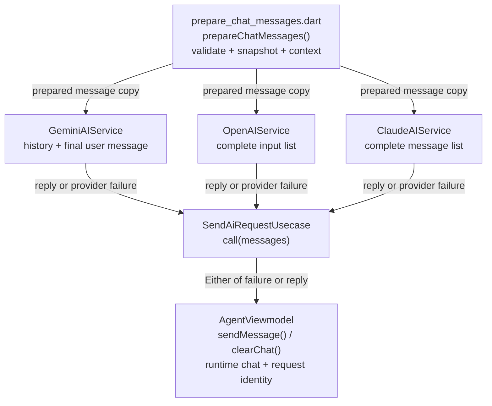

# Core AI Providers

## Purpose

The `flutter_ai_operator` package supports Gemini, OpenAI, and Claude behind the
`AIService` contract. It owns provider adapters and tool-call mapping; the app
chooses a provider and owns API keys and conversation state.
The caller supplies the provider, API key, model override, configuration, and
action handler at composition time.

## Entry Points

- `AIServiceFactory.create()` creates a Gemini, OpenAI, or Claude service from
  the provider, model ID, runtime key, AI configuration, and action handler
  supplied by the caller.
- Call `AIService.send(messages, additionalContext: ...)` through the AI use case when one-off extra context is needed.
  The ordered list includes the current user message as its final element.
- The app builds its one service in `AppInitializer.initializeAI()` (currently
  Gemini) and `main.dart` injects `AppInitializer.aiService`. No provider is a
  singleton; `create()` returns a new service every call, so whoever builds it
  owns it. To switch provider, change the `provider` passed there.

Example core-layer construction:

```dart
final service = AIServiceFactory.create(
  provider: AIProvider.openAI,
  modelName: 'gpt-6-luna',
  apiKey: userSuppliedApiKey,
  configuration: configuration,
  actionHandler: actionHandler,
);
```

## Responsibility Check

- `AIServiceFactory` — exposes a static `create()` method to select and construct
  a new provider adapter on each call. It
  owns no persistence, UI, API-key lifecycle, or provider selection policy. Its
  inputs come from the caller; its output is an `AIService` consumed by an
  application use case. It is runtime wiring.
- `prepareChatMessages()` — shared request preparation in
  `packages/flutter_ai_operator/lib/src/helpers/prepare_chat_messages.dart`.
  It validates caller-owned messages, takes an immutable request snapshot, and
  adds optional context to the copied final user message. Its output is consumed
  only by the three provider adapters. It owns no conversation, storage, or UI
  state; it is package request preparation.
- `GeminiAIService` — splits the prepared list into SDK history and the final
  user message, then owns the Firebase SDK request and tool-call loop. It is
  provider data/infrastructure and does not persist chat state.
- `OpenAIService` — owns Responses API payloads, its own tool envelope
  (`type: function`, `strict: false`), response parsing, and the function-call
  continuation loop. It receives its key and configuration from the factory and
  publishes plain response text to `AIService` consumers. It is provider
  data/infrastructure.
- `ClaudeAIService` — owns Messages API payloads, its own tool envelope
  (`input_schema`), response parsing, and the tool-use continuation loop. It
  receives its key and configuration from the factory and publishes plain
  response text to `AIService` consumers. It is provider data/infrastructure.
- `AIProviderClient` — owns HTTP configuration (base URL, headers, timeouts).
  It throws Dio's `DioException` and never throws `AIProviderFailure`. It
  returns `null` for a non-object body. It does not know request or response
  shapes. Used by OpenAI and Claude only.
- `AIProviderFailure`
  (`packages/flutter_ai_operator/lib/src/failures/ai_provider_failure.dart`) —
  base failure with `code` (int), `reason` (stable string such as
  `TOO_MANY_CALLS`) and an optional `message` (human detail, set only when
  there is some; do not branch on it). It is runtime-only. Request preparation
  raises invalid-input failures from caller messages; provider services raise
  the other subclasses (Gemini maps `FirebaseAIException` to
  `AIProviderRequestFailure` with code 0 and `FirebaseAISdkException` to
  `AIProviderInvalidResponseFailure`). `SendAiRequestUsecase` preserves these
  failures in its `Left` result and normalizes unexpected thrown values to
  `StateError` at the app boundary.
  Only `AIProviderRequestFailure` sets `message`, to the provider's own error
  text (for example "Incorrect API key"). No failure names the provider.

  | Subclass | code | reason | Thrown when |
  |---|---|---|---|
  | `AIProviderRequestFailure` | HTTP status, or 0 | `REQUEST_FAILED` | Network error or non-2xx |
  | `AIProviderTooManyCallsFailure` | 1001 | `TOO_MANY_CALLS` | Past `AIConstants.maxToolRounds` |
  | `AIProviderMalformedToolCallFailure` | 1002 | `MALFORMED_TOOL_CALL` | Tool call missing fields or bad arguments |
  | `AIProviderEmptyResponseFailure` | 1003 | `EMPTY_RESPONSE` | No text to show |
  | `AIProviderInvalidResponseFailure` | 1004 | `INVALID_RESPONSE` | Body not a JSON object, or no OpenAI response ID |
  | `AIProviderInvalidInputFailure` | 1005 | `INVALID_INPUT` | Empty list, final model message, or blank final user text |
- `JsonSchemaFunctionDefinitionMapper` — converts app function definitions to
  a provider-neutral JSON representation with `name`, `description`, and
  `parameters`. Its source is `AIConfiguration.functionDefinitions`; its
  output is wrapped in each provider's request fields by its adapter (OpenAI,
  Claude, and Gemini). It is provider data mapping.
- `AIProvider` — identifies which adapter the caller selects. It owns no model
  configuration, key lifecycle, or persistence.
- `AiActionHandler` — remains the existing capability boundary for app actions.
  The provider adapters call it for model-requested functions and return its
  success or failure to the provider.
- `SendAiRequestUsecase` — delegates the complete message list and context to
  `AIService`, returning an explicit success/failure result to presentation. It
  owns application error handling, without chat storage or provider payload rules.
- `AgentViewmodel` — owns the runtime chat list and pending-request identity.
  It passes the pending user message once, appends a reply on success, and rolls
  back that message on failure. It ignores overlapping sends and results from
  requests invalidated by clearing or closing. It is presentation state; the
  app's submitted messages are the source of truth, with no persistence here.

## Flow



Arrows show results flowing to consumers. The use case calls the selected
adapter through `AIService`; each adapter calls the shared preparation function.

## User flow

1. The caller selects `AIProvider` and supplies the provider key and model ID →
   `AIServiceFactory.create()` returns a service.
2. The view model adds the latest user message to its pending conversation and
   calls `SendAiRequestUsecase` → `AIService.send(messages)` validates and copies
   the complete list. Context is added only to the outgoing final user text.
3. Gemini passes earlier messages to `startChat()` and sends the final message
   separately. OpenAI and Claude map the whole prepared list into their payloads.
4. When the model requests a function → the adapter invokes `AiActionHandler`,
   returns the result to the provider, and continues until text is returned.
5. The view model appends the reply on success or restores the previous chat on
   failure. Clearing or closing invalidates pending results.

## ViewModel

```dart
Future<void> sendMessage(String userMessage);
void clearChat();
```

- `sendMessage()` publishes the pending user message and coordinates one send.
  Called by the chat UI; additional sends while loading are ignored.
- `clearChat()` resets the conversation and invalidates the pending request.
  Called when the user starts a new conversation.

### State

- `chatMessages` is app-owned runtime conversation state, including the pending
  user message while loading and the assistant message after success.
- `AgentInitial`, `AgentLoading`, `AgentLoaded`, and `AgentError` drive the chat
  UI; error state retains the prior successful conversation and its failure.
- A private request counter belongs to the view model and prevents stale
  results from changing a cleared, replaced, or closed conversation. It is not
  persisted or sent to the package.

The UI renders these states and calls the two public methods. Validation and
provider payload preparation remain in the package.

## Important Files

Under `packages/flutter_ai_operator/lib/src/`:

- `interfaces/ai_service.dart` — public complete-conversation send contract.
- `helpers/prepare_chat_messages.dart` — validation, snapshots, and request context.
- `service/ai_service_factory.dart` — provider construction entry point.
- `service/gemini/gemini_ai_service.dart` — Gemini adapter.
- `service/openai/openai_ai_service.dart` — OpenAI adapter.
- `service/claude/claude_ai_service.dart` — Claude adapter.
- `helpers/json_schema_function_definition_mapper.dart` — shared schema mapping.
- `service/shared/ai_provider_client.dart` — provider HTTP execution.
- `failures/ai_provider_failure.dart` — shared runtime failure types.

The app calls this package from
`lib/modules/agent/domain/usecases/send_ai_request_usecase.dart` and
`lib/modules/agent/presentation/viewmodel/agent_viewmodel.dart`.

## Dependencies

- OpenAI uses `POST https://api.openai.com/v1/responses` and function tools;
  `gpt-6-luna` is the documented sample model ID.
- Claude uses `POST https://api.anthropic.com/v1/messages`, tool-use blocks, and
  `claude-sonnet-5-5` is the documented sample model ID.
- Gemini uses `JsonSchemaFunctionDefinitionMapper` too. The SDK only builds
  declarations from its own typed schemas, so `GeminiAIService` wraps each
  mapped tool in a private `FunctionDeclaration` subclass that overrides
  `toJson()` and sends it as `parametersJsonSchema`. If a `firebase_ai` upgrade
  changes how `Tool` serializes declarations, tool calls on Gemini break first.
- Gemini continues to use the existing Firebase AI SDK and
  the caller-supplied model ID (the current app uses `gemini-3.5-flash-lite`).
- OpenAI and Claude API keys are supplied by the caller; these API products use
  separate billing from ChatGPT and Claude subscriptions.

Request and tool-call shapes follow the providers' docs: [OpenAI function
calling](https://developers.openai.com/api/docs/guides/function-calling),
[OpenAI models](https://developers.openai.com/api/docs/models), [Claude Messages
API](https://platform.claude.com/docs/en/api/messages/create), and [Claude model
IDs](https://platform.claude.com/docs/en/about-claude/models/model-ids-and-versions).

## Common Changes

- To add a provider, add an enum value, implement `AIService`, and add a
  construction branch in `AIServiceFactory`.
- Every provider must call `prepareChatMessages()` before SDK or HTTP work.
  Pass the complete list, including its final user message, and never append
  that message a second time or modify caller-owned messages.
- Keep each provider's tool envelope in its adapter and keep the canonical JSON
  definition and app-level `FunctionDefinition` provider-neutral.
- The tool-round limit is `AIConstants.maxToolRounds`.
- Keep API-key acquisition and persistence at the composition boundary; do not
  put secrets in `AIConfiguration`, chat messages, or logs.

## Testing

- Run `flutter test --no-pub` from `packages/flutter_ai_operator` for package
  tests. Run `flutter test --no-pub` from the app root for application tests.
- The shared provider contract covers invalid lists rejected before requests,
  chronological order without duplicates, context only on a final request copy,
  and caller-list changes while a request is pending.
- Agent tests cover success, failure rollback and retry, overlapping sends,
  clearing during a request, and closing before a reply arrives.
- Use mock HTTP responses to verify each provider's request shape, text parsing,
  API error normalization, and malformed-response handling.
- Verify successful and failed function execution flows for each adapter,
  including multiple tool calls and the 12-round loop limit.
- Confirm `AIServiceFactory` rejects missing keys for OpenAI and Claude while
  Gemini construction remains keyless.

## Edge Cases

- An empty message list, final model message, or blank final user text raises
  `AIProviderInvalidInputFailure` before contacting a provider. App context
  cannot make a blank user message valid.
- The package owns only a per-request immutable snapshot. It does not append
  replies, persist messages, cache responses, or supply an offline fallback.
- Gemini, OpenAI, and Claude failures are thrown as `AIProviderFailure`
  subclasses by the service (not the client); the existing
  `SendAiRequestUsecase` boundary can surface these through the agent's current
  failure state. Missing API keys are still a `StateError` from
  `AIServiceFactory`.
- A Gemini response blocked for safety surfaces as `AIProviderRequestFailure`
  with code 0 and the SDK's explanation in `message`.
- Tool calls run sequentially through the existing action handler and each
  adapter (including Gemini) stops after `AIConstants.maxToolRounds` (12)
  consecutive tool rounds. An empty reply is `AIProviderEmptyResponseFailure`
  for all three.
- Malformed tool arguments and responses fail explicitly instead of becoming an
  empty assistant reply.
- OpenAI function tools are sent with `strict: false`. Strict mode requires
  every property to be required, which does not fit optional parameters. If
  `strict` is omitted, the Responses API tries to convert the schema to strict
  mode and falls back to non-strict when it cannot.
- Callers should supply user-owned keys rather than a shared app key.
