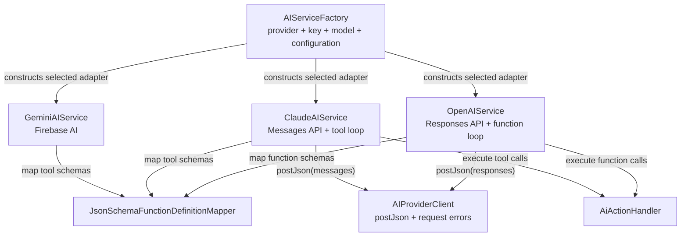

# Core AI Providers

## Purpose

The core AI layer supports Gemini, OpenAI, and Claude behind the existing
`AIService` contract. This change adds provider-specific HTTP adapters and
tool-call mapping; it does not choose a provider for the app or store API keys.
The caller supplies the provider, API key, model override, configuration, and
action handler at composition time.

## Entry Points

- `AIServiceFactory.create()` creates a Gemini, OpenAI, or Claude service from
  the provider, model ID, runtime key, AI configuration, and action handler
  supplied by the caller.
- Call the resulting `AIService.send()` through the existing AI use case.

Example core-layer construction:

```dart
final service = const AIServiceFactory().create(
  provider: AIProvider.openAI,
  modelName: 'gpt-6-luna',
  apiKey: userSuppliedApiKey,
  configuration: configuration,
  actionHandler: actionHandler,
);
```

## Responsibility Check

- `AIServiceFactory` — exists to select and construct a provider adapter. It
  owns no persistence, UI, API-key lifecycle, or provider selection policy. Its
  inputs come from the caller; its output is an `AIService` consumed by an
  application use case. It is runtime wiring.
- `OpenAIService` — owns Responses API payloads, its own tool envelope
  (`type: function`, `strict: false`), response parsing, and the function-call
  continuation loop. It receives its key and configuration from the factory and
  publishes plain response text to `AIService` consumers. It is provider
  data/infrastructure.
- `ClaudeAIService` — owns Messages API payloads, its own tool envelope
  (`input_schema`), response parsing, and the tool-use continuation loop. It
  receives its key and configuration from the factory and publishes plain
  response text to `AIService` consumers. It is provider data/infrastructure.
- `AIProviderClient` — owns HTTP configuration (base URL, headers, timeouts).
  It throws Dio's `DioException` and never throws `AIProviderFailure`. It
  returns `null` for a non-object body. It does not know request or response
  shapes. Used by OpenAI and Claude only.
- `AIProviderFailure` (`lib/core/domain/failures/ai_provider_failure.dart`) —
  base failure with `code` (int), `reason` (stable string such as
  `TOO_MANY_CALLS`) and an optional `message` (human detail, set only when
  there is some; do not branch on it). It is runtime-only. Only the three
  provider services throw its subclasses (Gemini maps `FirebaseAIException` to
  `AIProviderRequestFailure` with code 0 and `FirebaseAISdkException` to
  `AIProviderInvalidResponseFailure`); `SendAiRequestUsecase` catches them.
  Only `AIProviderRequestFailure` sets `message`, to the provider's own error
  text (for example "Incorrect API key"). No failure names the provider.

  | Subclass | code | reason | Thrown when |
  |---|---|---|---|
  | `AIProviderRequestFailure` | HTTP status, or 0 | `REQUEST_FAILED` | Network error or non-2xx |
  | `AIProviderTooManyCallsFailure` | 1001 | `TOO_MANY_CALLS` | Past `AIConstants.maxToolRounds` |
  | `AIProviderMalformedToolCallFailure` | 1002 | `MALFORMED_TOOL_CALL` | Tool call missing fields or bad arguments |
  | `AIProviderEmptyResponseFailure` | 1003 | `EMPTY_RESPONSE` | No text to show |
  | `AIProviderInvalidResponseFailure` | 1004 | `INVALID_RESPONSE` | Body not a JSON object, or no OpenAI response ID |
- `JsonSchemaFunctionDefinitionMapper` — converts app function definitions to
  a provider-neutral JSON representation with `name`, `description`, and
  `parameters`. Its source is `AIConfiguration.functionDefinitions`; its
  output is wrapped in each provider's request fields by its adapter (OpenAI,
  Claude, and Gemini). It is provider data mapping.
- `AIProvider` — identifies which adapter the caller selects. It owns no model
  configuration, key lifecycle, or persistence.
- `AiActionHandler` — remains the existing capability boundary for app actions.
  The provider adapters call it for model-requested functions and return its
  success or failure to the provider.

## Flow



## User flow

1. The caller selects `AIProvider` and supplies the provider key and model ID →
   `AIServiceFactory.create()` returns a service.
2. An application use case calls `AIService.send()` → the adapter maps chat
   history and configuration to the provider API.
3. When the model requests a function → the adapter invokes `AiActionHandler`,
   returns the result to the provider, and continues until text is returned.

## Important Files

- `lib/core/ai/service/ai_service.dart` — provider-neutral service contract.
- `lib/core/ai/service/ai_service_factory.dart` — provider construction entry point.
- `lib/core/ai/service/openai/openai_ai_service.dart` — OpenAI adapter.
- `lib/core/ai/service/claude/claude_ai_service.dart` — Claude adapter.
- `lib/core/ai/service/json_schema_function_definition_mapper.dart` — shared
  tool-schema mapping.
- `lib/core/ai/service/ai_provider_client.dart` — provider HTTP client and
  normalized request errors.
- `lib/core/ai/models/ai_provider.dart` — provider identifiers.

## Dependencies

- OpenAI uses `POST https://api.openai.com/v1/responses` and function tools;
  `gpt-6-luna` is the documented sample model ID.
- Claude uses `POST https://api.anthropic.com/v1/messages`, tool-use blocks, and
  `claude-sonnet-5-5` is the documented sample model ID.
- Gemini uses `JsonSchemaFunctionDefinitionMapper` too. The SDK only builds
  declarations from its own typed schemas, so `GeminiAIService` wraps each
  mapped tool in a private `FunctionDeclaration` subclass that overrides
  `toJson()` and sends it as `parametersJsonSchema`. If a `firebase_ai` upgrade
  changes how `Tool` serializes declarations, tool calls on Gemini break first.
- Gemini continues to use the existing Firebase AI SDK and
  the caller-supplied model ID (the current app uses `gemini-3.5-flash-lite`).
- OpenAI and Claude API keys are supplied by the caller; these API products use
  separate billing from ChatGPT and Claude subscriptions.

Request and tool-call shapes follow the providers' docs: [OpenAI function
calling](https://developers.openai.com/api/docs/guides/function-calling),
[OpenAI models](https://developers.openai.com/api/docs/models), [Claude Messages
API](https://platform.claude.com/docs/en/api/messages/create), and [Claude model
IDs](https://platform.claude.com/docs/en/about-claude/models/model-ids-and-versions).

## Common Changes

- To add a provider, add an enum value, implement `AIService`, and add a
  construction branch in `AIServiceFactory`.
- Keep each provider's tool envelope in its adapter and keep the canonical JSON
  definition and app-level `FunctionDefinition` provider-neutral.
- The tool-round limit is `AIConstants.maxToolRounds`.
- Keep API-key acquisition and persistence at the composition boundary; do not
  put secrets in `AIConfiguration`, chat messages, or logs.

## Testing

- Use mock HTTP responses to verify each provider's request shape, text parsing,
  API error normalization, and malformed-response handling.
- Verify successful and failed function execution flows for each adapter,
  including multiple tool calls and the 12-round loop limit.
- Confirm `AIServiceFactory` rejects missing keys for OpenAI and Claude while
  Gemini construction remains keyless.

## Edge Cases

- Gemini, OpenAI, and Claude failures are thrown as `AIProviderFailure`
  subclasses by the service (not the client); the existing
  `SendAiRequestUsecase` boundary can surface these through the agent's current
  failure state. Missing API keys are still a `StateError` from
  `AIServiceFactory`.
- A Gemini response blocked for safety surfaces as `AIProviderRequestFailure`
  with code 0 and the SDK's explanation in `message`.
- Tool calls run sequentially through the existing action handler and each
  adapter (including Gemini) stops after `AIConstants.maxToolRounds` (12)
  consecutive tool rounds. An empty reply is `AIProviderEmptyResponseFailure`
  for all three.
- Malformed tool arguments and responses fail explicitly instead of becoming an
  empty assistant reply.
- OpenAI function tools are sent with `strict: false`. Strict mode requires
  every property to be required, which does not fit optional parameters. If
  `strict` is omitted, the Responses API tries to convert the schema to strict
  mode and falls back to non-strict when it cannot.
- Callers should supply user-owned keys rather than a shared app key.
